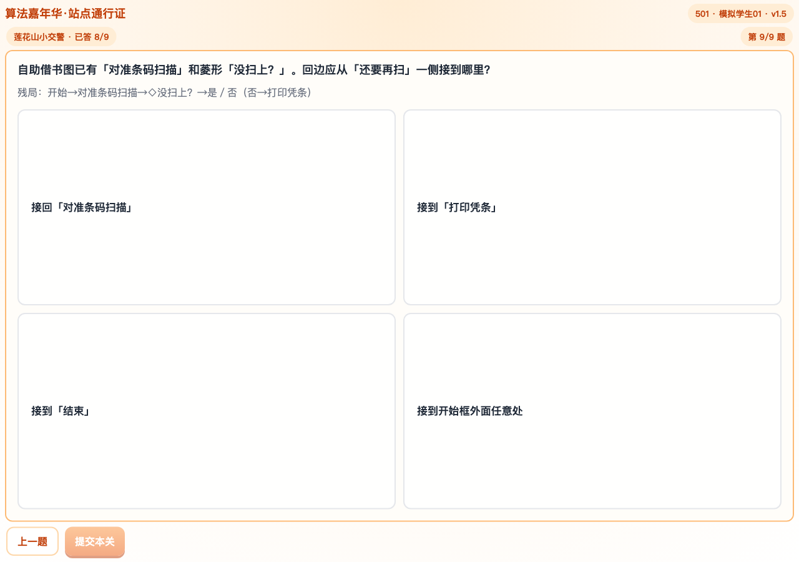

# 五年级期中 v1.5 · 无图题全屏修复验收

日期：2026-11-17（Asia/Shanghai）

## 问题与修复

无图题在1280×900视口下未使用页面剩余高度。以M52为例，翻页/提交按钮底部停在y=477.45，下方空约422.55px。原因是无图题外层、正文和选项网格均被覆盖为不增长，选项高度又被限制为148px。

本次只调整无图题专用规则的五个声明，使题区、正文和选项网格使用剩余高度，解除按钮高度上限，保留既有题区滚动与控件最小高度。地图底部删除“学生端不显示答案与解析”一句，保留学生操作提示。

生产代码仅改 `app/client/src/styles.css` 和 `app/client/src/App.jsx`。题库、计分、解锁、服务端持久化和带图题专用布局均未修改。

## 环境与版本

- 基线：`main@6f78602847e795ba687bf3a2edbe8834ded2be29`。
- 修复分支：`fix/g5-midterm-fullscreen-20261117`，不合并main。
- 题库版本：`2026-11-10-midterm-v1.5`，主卷52题、挑战5题。
- 题库SHA-256：`a04e054fb7daef67c0dda82dc013befc992c7983e97aec86a78a311f5efa7fb5`，修复前后相同。
- 浏览器：Google官方Mac ARM64快照的真实Chromium `109.0.5412.0`，没有修改UA。
- 宿主：macOS 13.7.8 / Apple M1，headless；这不是Win7机房实测。
- 仅使用4个虚构学生、独立DATA_DIR和18817/18818测试端口；没有使用真实学生记录或部署到课堂服务。
- 构建目标保持 `es2019` / `chrome87`。

## 检测结果

| 状态 | 检查 | 结果 |
|---|---|---|
| PASS | `npm run build` | 生产构建成功 |
| PASS | `npm run test:grade` | 11/11 |
| PASS | `npm run selftest` | 37/37，虚构名单及临时数据 |
| PASS | 真实109完整答题流程 | 405条断言，0 FAIL；主卷52题、挑战5题、交卷和教师屏均走通 |
| PASS | 逐站刷新及最终重新登录 | 服务端完成/解锁字段与地图一致，新无痕上下文保留主卷100和挑战+10 |
| PASS | 四视口全题巡查 | 1280×900、1366×768、1024×768、1024×600；4×57=228个题目页面，1268 PASS、0 FAIL、0 WARN |
| PASS | 无图题填满 | 所有无图题导航底距≤24px；M52四个视口均为10px，网格与正文内容区的宽度及下沿相符 |
| PASS | 操作可达 | 无横向溢出、被裁剪控件、被裁剪回忆图区或越出视口的导航按钮 |
| PASS | 翻页与滚动 | 每页实际滚轮后切题，无旧滚动遮挡下一题；当前57题在四视口中均无需内部滚动 |
| PASS | 学生地图文案 | 实现说明句不再显示，既有学生操作提示保留 |
| PASS | 带图题布局对照 | 与基线三个共同视口的29道带图题逐一比较，共87条题目/视口记录；题区、回忆图、正文框几何在0.01px精度一致 |
| PASS | 浏览器错误 | 全流程无实质console/pageerror；低分辨率巡查无页面JS错误 |

这里的PASS是软件模拟检测结果，不代表真实学生施测或Win7低配设备流畅度已验证。

## M52前后几何

| 视口 | 修复前导航底部 | 修复后导航底部 | 修复后下方留白 |
|---|---:|---:|---:|
| 1280×900 | 477.45px | 890px | 10px |
| 1366×768 | 477.45px | 758px | 10px |
| 1024×768 | 477.45px | 758px | 10px |
| 1024×600 | 477.45px | 590px | 10px |

1280×900的修复前数据为本次真实109重新测量；其他修复前视口取自同一基线的既有检测记录。四个修复后视口均为本次新测。

下方对照图均为M52首次未答状态。修复前截图取自相同main基线的首轮检测，避免将“已答回看”与“首次未答”的选中状态混作布局变化。

### 修复前：题区外留下大块空白

### 修复后：无图题使用可用高度

## 复现步骤

1. 构建客户端，设置独立 `DATA_DIR` 与虚构名单的 `ROSTER_PATH` 后，在空闲隔离端口启动应用。
2. 通过界面登录虚构身份，完成主卷各站后进入“莲花山小交警”，切至第9/9题M52。
3. 在表列四种视口观察题区、选项和底部按钮；按钮底部应距视口下沿约10px，页面无空图位。
4. 检查三槽、排序、匹配及带图题；实际滚轮并翻页，确认题干、回忆图及控件可达。
5. 回到地图，确认只保留学生操作提示，不再出现“学生端不显示答案与解析”。

## 保留的验证边界

Win7机房、稳定版Google Chrome109、旧显卡驱动和真实局域网并发仍需实际环境验证。回忆图的模糊背景未在本次范围中修改。

本PR使用正式v1.5题库。指定哈希为 `a79c82d9775645ab6121208f5f2abf1c9ff995afb5bfc84fb18d5aefb1fc5315` 的v1.5.1三份定稿文件仍未取得，因此本PR不包含题库升级。
